# Spectrum

A mobile Augmented Reality experience for Spectrum Center that treats the cityscape as a platform — letting visitors step through virtual gates into layered digital spaces overlaid on the real world.

<p align="center">
  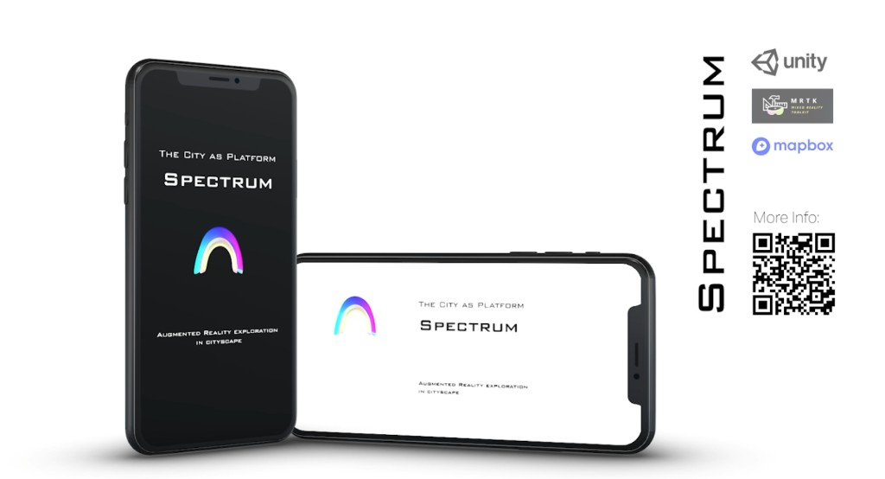
</p>

**Demo video:** [vimeo.com/489187386](https://vimeo.com/489187386)

<table>
  <tr>
    <td align="center" width="50%">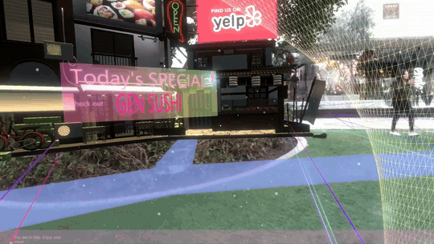<br/><strong>Yelp Gate — restaurant specials</strong></td>
    <td align="center" width="50%">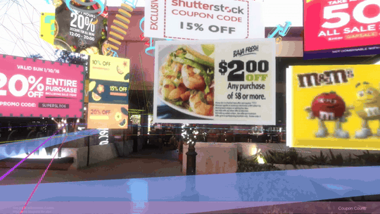<br/><strong>Info Desk — floating coupon wall</strong></td>
  </tr>
</table>

<p align="center">
  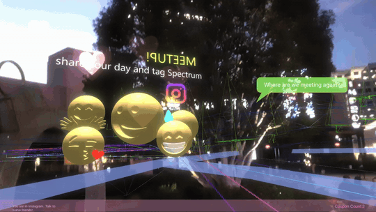
</p>

<p align="center"><em>Social Media / Meetup Corner — share your day and tag Spectrum</em></p>

---

## Overview

Spectrum takes public space at Spectrum Center (Southern California) as a hybrid stage between the virtual and the physical. Visitors open a welcome interface on site, then choose among **seven virtual gates**. Each gate leads into a different digital layer — restaurant info, coupons and promotions, or a social meetup space — visualized directly over the plaza.

Information becomes another layer of the city: people can see, hear, and interact with AR content while browsing digital services in place. The goal is a multi-sensory experience that changes how people use public space and encourages engagement and communication in a digital era.

A special Christmas scene was also built for the holiday season.

### Key Features

- Location-based AR experience designed for Spectrum Center plaza
- Welcome interface with seven branded virtual gates
- Spatial zone switching via area colliders (Yelp, Info Desk, Social Media)
- Restaurant and business overlays (e.g. Gen Sushi specials via Yelp gate)
- Floating coupon wall for collecting digital deals
- Social / Meetup corner with 3D emoji and chat overlays
- Holiday AR props (Santa, Christmas tree, festive plaza content)
- Plane and point-cloud visualization with AR Foundation

---

## Interface Preview

### Site Context

<table>
  <tr>
    <td align="center" width="50%">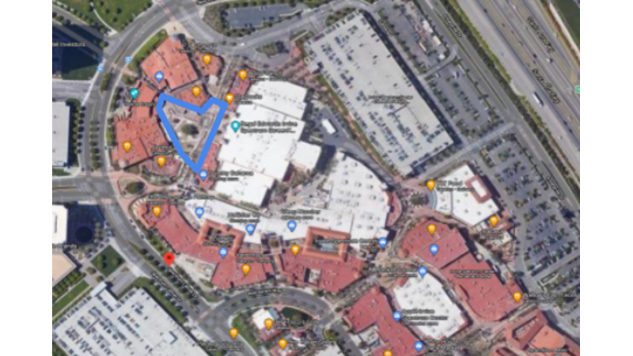<br/><strong>Site Location</strong></td>
    <td align="center" width="50%">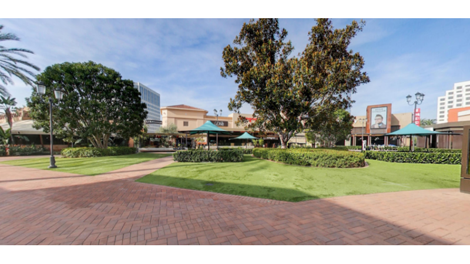<br/><strong>Site Picture</strong></td>
  </tr>
  <tr>
    <td align="center" width="50%">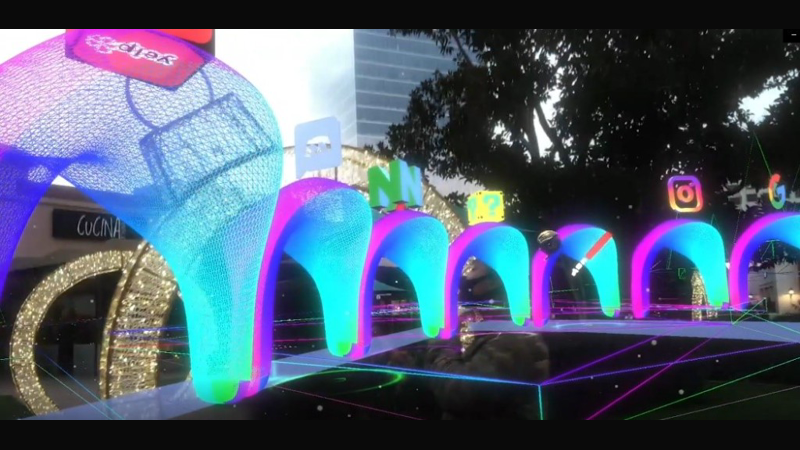<br/><strong>App Interface on Site</strong></td>
    <td align="center" width="50%">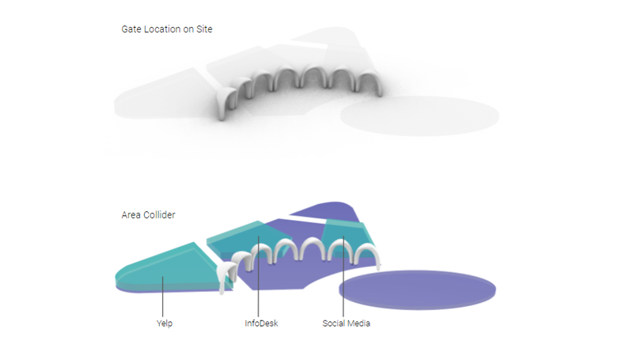<br/><strong>Gate Location &amp; Area Colliders</strong></td>
  </tr>
</table>

### Welcome and Gate Selection

| 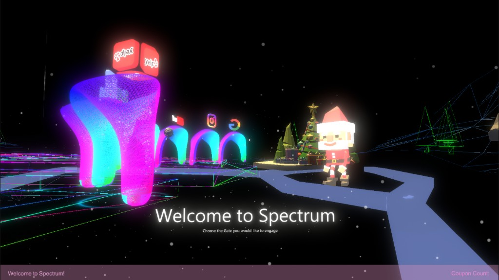 **Welcome to Spectrum** | 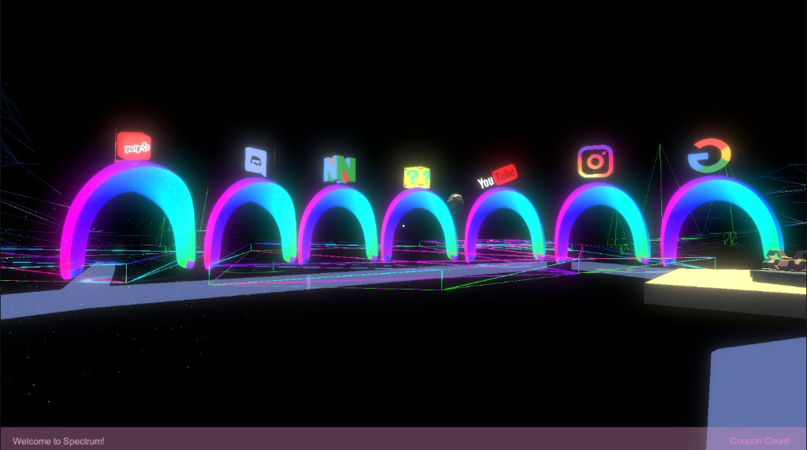 **Seven Virtual Gates** |
| --- | --- |
| 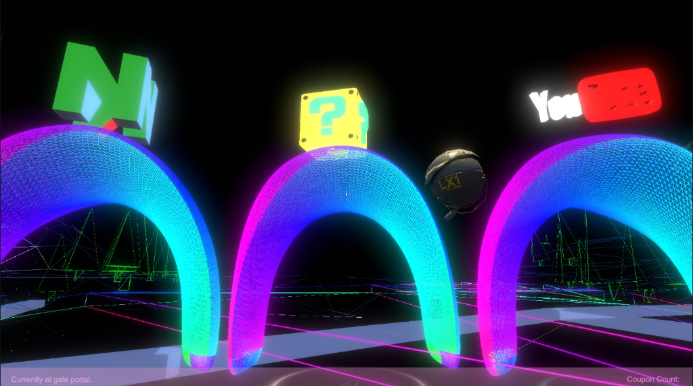 **Gate Portal Detail** | 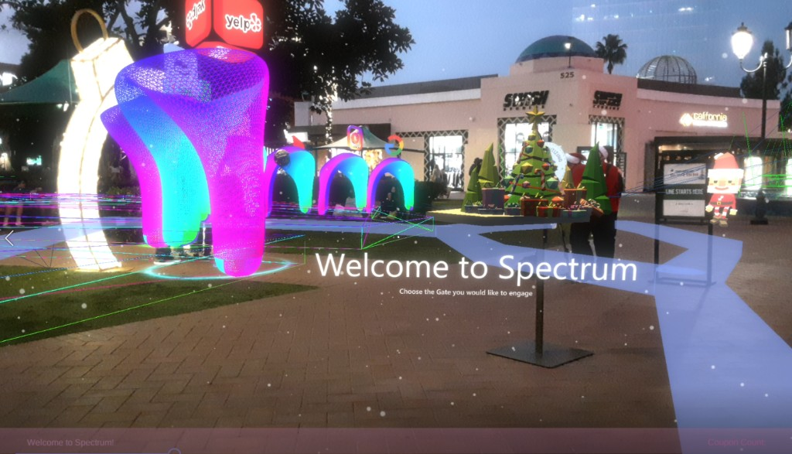 **On-Site Welcome Overlay** |

### Full Scene and UI Concept

<p align="center">
  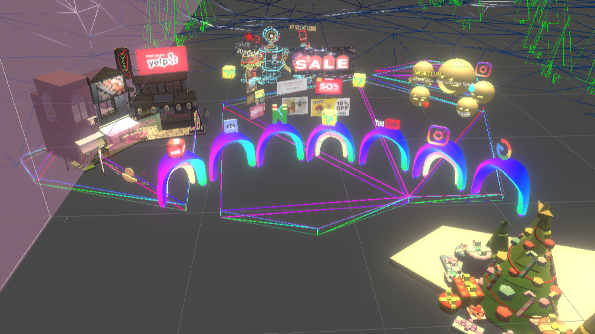
</p>

<p align="center"><em>Virtual hub combining gates, storefronts, coupons, social emojis, and holiday props</em></p>

<p align="center">
  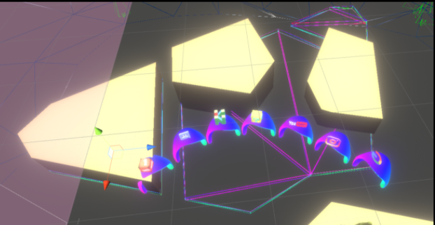
</p>

<p align="center"><em>Early UI / launcher concept with branded gate icons</em></p>

---

## Built With

- Unity
- AR Foundation
- MRTK (Mixed Reality Toolkit)
- Mapbox
- Sketchfab / Unity Asset Store content for props and icons

---

## Technical Highlights

- Built a mobile AR pipeline that anchors neon gate portals and digital content to a real outdoor plaza
- Organized interaction zones with area colliders that switch between gate, Yelp, Info Desk, and Instagram scenes
- Layered brand-driven portals (Yelp, Discord, YouTube, Instagram, Google, and more) as spatial “doors” into digital services
- Implemented coupon collection and social meetup overlays as on-site multi-sensory experiences
- Combined Mapbox location context with Unity AR plane / point-cloud visualization for site-aware placement

---

## Project Structure

```text
spectrum/
├── images/                 # README previews, site photos, and experience GIFs
├── ARTapToPlaceObject.cs   # Tap-to-place AR object placement
├── ToggleAr.cs             # Toggle AR plane / point-cloud visualization
├── EnteringDoor.cs         # Gate zone switching (Yelp / Info / Instagram)
├── EnteringDoor1.cs
├── EnteringDoor2.cs
├── MainMenu.cs             # Scene navigation
├── Collect.cs              # Collectable interaction logic
├── Coupon.cs               # Coupon-related behavior
├── Rotate.cs
├── SimpleCameraController.cs
└── README.md
```
